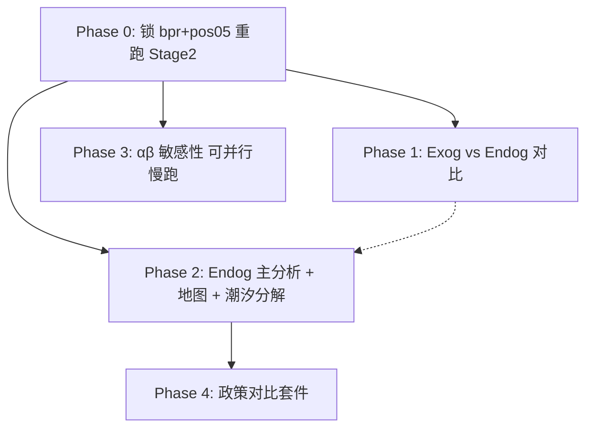

# 主线工作计划 — 新对话 Handoff（2026-06-30）

> **用途：** 在新 Cursor 对话中粘贴或引用本文，作为唯一任务规格。  
> **前置结论 memo：** `Documents/L2_notes/model_and_results_summary_20260630.md`  
> **政策对比原始 plan：** `nextstep.md` §「政策反事实对比套件」

---

## 0. 已锚定的主线（后续所有操作默认遵守）


| 维度                    | 锁定值                                                       | 说明                                                                                  |
| --------------------- | --------------------------------------------------------- | ----------------------------------------------------------------------------------- |
| **Travel cost input** | `data_work/outputs/model_input_edgeproj_v2_lcc_gate5_v1`  | grid-to-grid；edgeproj_v2 + LCC + detour gate G=5                                    |
| **车道数**               | 同上 bundle 内 **lane-fix 后** 版本                             | 2026-06-29 修正 roadseg lane lookup                                                   |
| **选边**                | `**score_bpr_st`**                                        | \Xi_s(\tau_s-\tau_s^{ff})-\Xi_f(\tau_f-\tau_f^{ff})，q=\Xi^{baseline}；**不再是 `asym`** |
| **参数**                | **α = +0.05, β = −0.10**                                  | 文献 gross α + Seattle β；正 α 求解器需 `damping=0.10, max_outer=500, tol=1e-4`             |
| **拥堵**                | `**anchored`**，**λ_phys = 1.1**（主）；**λ = 0.57**（稳健性 band） | semi-lock at τ_obs                                                                  |
| **潮汐规模**              | top **100** 对，Δn = **1**                                  | slow +1 / fast −1                                                                   |
| **节点**                | N = 1104（gate5 LCC）                                       | period = AM                                                                         |


**代码待改默认值（Phase 0 第一件事）：**

- `equilibrium_solve.py` → `MAINLINE_PAIR_SELECTION = "score_bpr_st"`
- `run_stage2_gate5.py` / batch 脚本 → 默认 `Parameters(alpha=0.05, beta=-0.10)` + pos05 solver overrides
- 所有新脚本 **禁止** 静默回退到 `asym` 或 α=−0.12，除非显式标注 `robustness`

**新输出命名约定：**

```
outputs/stage2_endogenous_edgeproj_v2_lcc_gate5_bpr_pos05_v1/
outputs/tidal_lane_diagnostics_*_bpr_pos05_v1/
outputs/policy_comparison_gate5_bpr_pos05_v1/
```

---

## 1. 整体叙事（论文 / slides 逻辑链）

```
数据层: 方向性 τ + 修正车道 n_kl
    ↓
Layer A — Exogenous τ（不内生拥堵）
    目的: 对称 vs 不对称 travel cost 如何改变 CF 解读（无 feedback）
    ↓
Layer B — Endogenous anchored congestion（主模型）
    目的: fundamental 直觉图 + 标准 CF + 潮汐 ST/LT 全分解
    ↓
Layer C — α,β 敏感性（机制，可慢做）
    ↓
Layer D — 交通政策 cost-effectiveness 对比（潮汐定位 = 便宜 + 定向，非福利最大）
```

**Punchline（政策对比）：**

- First-best 拥堵定价：福利最大、≈0 基建成本 → **性价比上界**
- 道路扩张：raw 效果大但贵，LT 被诱增需求侵蚀
- **潮汐车道：效果小、净零 lane-km 成本、分配定向、比定价易落地**
- Uniform speedup（CF3）：**无成本天花板**，非真实政策

---

## 2. Phase 0 — 锁定主线并重跑 baseline（必须先做）

### 0.1 任务

1. 改 `MAINLINE_PAIR_SELECTION` 与默认参数（见 §0）。
2. 全量重跑 Stage2 gate5（**非 quick**）：
  ```bash
   cd data_work
   python3 src/model/full_estimation/run_stage2_gate5.py \
     --version-id model_input_edgeproj_v2_lcc_gate5_v1 \
     --output-name stage2_endogenous_edgeproj_v2_lcc_gate5_bpr_pos05_v1 \
     --pair-selection score_bpr_st \
     --congestion-form anchored --congestion-lambda 1.1
  ```
   需在 driver 层传入 α=+0.05（若 CLI 未支持，扩展 `--alpha 0.05 --beta -0.10`）。
3. 跑 tidal diagnostics + welfare/sorting 包（已有脚本，改 output-name）：
  - `run_tidal_lane_diagnostics_gate5.py`
  - `run_welfare_sorting_diagnostics_gate5.py`（仅 pos05 轨即可，或三轨 robustness）

### 0.2 验收（与旧 asym 结果对照）


| 指标             | 旧 asym+pos05 | 新 **bpr+pos05** 预期 |
| -------------- | ------------ | ------------------ |
| ST direct      | −0.79 s      | **≈ −1.63 s**      |
| sorting wedge  | +0.86 s      | **≈ +0.71 s**      |
| LT total       | +0.60 s      | **≈ +0.07 s**      |
| person-min/day | +884         | **≈ +95**          |
| W̄ ST          | +0.32%       | ≈ +0.32%           |
| W̄ LT          | −0.37%       | 略不同，仍小幅负           |


### 0.3 产出

- `stage2_..._bpr_pos05_v1/` 全套 equilibrium + CF CSV
- 更新 `model_and_results_summary_*.md` 中主规格为 bpr+pos05

---

## 3. Phase 1 — Exogenous τ 模型（Layer A）

### 3.1 模型定义

- **Baseline：** `solve_baseline_exogenous_tau` — τ 钉在观测/输入，**不跑 (E6) 外循环**。
- 同样 invert fundamentals、同样 gravity sorting；政策只改 τ 或 τ_ff/n（视 policy 而定），**不反馈 Ξ**。
- 已有入口：`run_stage2_gate5.py` → `baseline_exogenous_tau` + `tidal_lane_exogenous_bpr_grid`。

### 3.2 要问的问题

1. **对称 vs 定向 τ：** CF1（symmetric cost）在 exog vs endog 下 W̄ / person-min 差多少？
2. **潮汐 exog BPR grid：** `run_tidal_exogenous_bpr_grid` — 固定 Ξ 下 lane realloc 的 τ 变化是否仍显示「慢向受益」？
3. **Exog vs endog 对同一 CF 的排序是否一致？** 例：CF3 uniform > tidal？方向是否翻转？

### 3.3 具体任务


| #   | 任务                                                                                                                              | 脚本/动作                                           |
| --- | ------------------------------------------------------------------------------------------------------------------------------- | ----------------------------------------------- |
| 1.1 | 从 Phase 0 的 stage2 输出读取 exog baseline                                                                                           | 已有                                              |
| 1.2 | 跑 **structural CF1/CF2/CF3** 的 **exogenous** 版本（若缺，在 `stage2_counterfactuals.py` 加 `run_structural_exogenous` 或复用 policy CF 框架） | 待实现或扩展                                          |
| 1.3 | 对比表：`exog vs endog` × `{CF1, CF2_bpr, CF3_1.10, policy specs}` × `{W̄, person-min, Δτ_corridor}`                                | 新脚本 `run_exog_endog_comparison_gate5.py`        |
| 1.4 | 短 memo：对称成本「抹平方向性」在 exog 下是否夸大福利；endog 下 feedback 如何修正                                                                          | `Documents/L2_notes/exog_vs_endog_framing_*.md` |


### 3.4 常见反事实（两模型都要报）


| CF          | 代码中对应                                            | Exog            | Endog          |
| ----------- | ------------------------------------------------ | --------------- | -------------- |
| 对称成本 CF1    | `run_cf1_symmetric`                              | 需补 exog 版       | ✓ 已有           |
| 潮汐 CF2      | `run_cf2_tidal` / tidal endog                    | exog BPR grid   | ✓ score_bpr_st |
| 均匀扩张 CF3    | `run_cf3_uniform(factor)`                        | 需补              | ✓ 已有           |
| Place-based | `PolicySpec` in `run_all_policy_counterfactuals` | ✓ 已有 exog+endog | ✓ 已有           |
| 人口增长        | **待实现** — scale Lbar 或 χ                         | 待实现             | 待实现            |
| 城市扩张        | fringe/outer τ 或 ubar（见 Phase C composite）       | 部分有             | 部分有            |


**人口增长 / 城市扩张** 若 stage2 无现成 spec，在 Phase 1 末或 Phase 2 初加 `PolicySpec`：`Lbar_scale=1.25` 或复用 `run_composite_cf_gate5.py` 的 fringe/hub specs。

---

## 4. Phase 2 — Endogenous 主模型（Layer B，核心）

### 4.1 Fundamental 图（intuition）

**目标：** 让读者看见 invert 出来的 **ū, ā** 与城市空间结构的关系。


| 图     | 变量                                      | 建议                                 |
| ----- | --------------------------------------- | ---------------------------------- |
| Map A | `fund.ubar_theta`（或 ubar 水平）            | 与 L_R_obs 对比                       |
| Map B | `fund.abar_theta`                       | 与 L_F_obs / employment centroid 对比 |
| Map C | baseline **Π_i, P_j**                   | 与 dist-to-hub                      |
| Map D | **Π_i^{−θ} 对 W̄ 的贡献** `u_i * Pi_i^{-θ}` | 福利地理权重                             |


**脚本：** 新建 `run_fundamental_maps_gate5.py`；输入 Phase 0 stage2 fundamentals + baseline equilibrium。

**Intuition 要点（写作）：**

- ū, ā 是 **Rationalize 观测 OD+τ 的 residual**；不是外生 GIS 变量。
- α=+0.05 → 均衡时 **岗向 hub 放大**；β=−0.10 → **密集区居住 amenity 惩罚**。
- Treat 走廊与高 Ξ、高 ℓ^H 相关（BPR 分数 corr Ξ≈0.91）→ 政策 shock 非空间均匀。

### 4.2 标准反事实 — Exog vs Endog 对比表

在 **endogenous anchored** 下重报（**score_bpr_st, top100**）：


| CF                                                       | 关键输出                               |
| -------------------------------------------------------- | ---------------------------------- |
| CF1 symmetric                                            | W̄, person-min, 与 directed tidal 差 |
| CF2 tidal ST/LT                                          | 见 §4.3                             |
| CF3 uniform ×1.10                                        | **ceiling**（无成本上界）                 |
| Place-based（hub prod / outer amenity / fringe transport） | `policy_cf_all_modes.csv` 中已有      |


每个 CF 报：**exog τ row vs endog row**（已有 `run_all_policy_counterfactuals` 结构）。

### 4.3 潮汐车道 — 主分析包（ST / LT / 全分解）

**必须输出的分解（每个 horizon）：**

1. **通勤 OD 分解**（`od_cost_decomposition`）
  - ST direct / GE wedge / sorting wedge → person-min/day
2. **W̄_θ 分解**（`run_welfare_sorting_diagnostics_gate5.py`）
  - composition-fixed (ST) vs sorting  
  - sorting → Δu vs ΔΠ
3. **Π 四层分解**
  - ① ST τ @ ℓ⁰  
  - ② LT τ GE @ ℓ⁰  
  - ③ +Δℓ^H  
  - ④ +Δℓ^L
4. **空间**
  - Δlog ℓ^R, Δlog ℓ^H, Δlog Π 地图 + **BPR treat 端点标注**  
  - `endpoint_group_summary.csv`
5. **Market access**
  - 节点 Δlog Π；加权和 vs W̄ 变化对照（解释「Δlog Π 平均为正但 W̄ 降」）

**主规格数字锚点（bpr+pos05，待 Phase 0 重跑确认）：**

- ST direct ≈ **−1.63 s**；sorting ≈ **+0.71 s**；LT ≈ **+0.07 s**；person-min ≈ **+95/day**
- W̄ ST **+0.32%**；W̄ LT 小幅负；sorting 对 W̄_θ 损失经 **Π** 而非 u

### 4.4 产出目录

```
outputs/tidal_mainline_bpr_pos05_v1/
  tidal_st_lt_compact.csv
  wbar_theta_decomposition.json
  pi_inv_decomposition.json
  maps/
  memo_tidal_mainline.md
```

---

## 5. Phase 3 — α, β 敏感性（Layer C，低优先级 / 可慢跑）

### 5.1 网格设计


| 固定        | 扫描                                        |
| --------- | ----------------------------------------- |
| β = −0.10 | α ∈ {−0.12, 0, 0.02, 0.03, 0.05, 0.10}    |
| α = +0.05 | β ∈ {−0.10, 0, +0.05, +0.10}（β>0 部分可能不收敛） |


**选边：** 全程 `score_bpr_st`；拥堵 anchored λ=1.1。

### 5.2 每个格子报

- person-min ST/LT；sorting wedge 符号；W̄ ST/LT
- W̄_θ 分解（ST vs sorting）；Π 四层（可子样本）
- 收敛 flag；pos α 用 `solver_overrides_for_params`

### 5.3 脚本

- 扩展 `run_alpha_robustness_quick_gate5.py` 或 `run_welfare_sorting_diagnostics` 批处理
- 输出：`outputs/alpha_beta_sensitivity_bpr_pos05_v1/sensitivity_grid.csv`
- 图：α vs sorting wedge；α vs person-min（固定 β=−0.10）→ **打平点 ~0.02**

### 5.4 机制叙事

- **person-min 符号** ≈ α–β tradeoff（正 α + 负 β → sorting 侵蚀 ST）
- 2026-07-01 welfare gauge 修正后，基础收敛网格内 **W̄ LT 为正**；raw `(Π,P)` 四层分解只作诊断，主福利用原始 Frechet denominator

---

## 6. Phase 4 — 政策反事实对比套件（Layer D）

> 完整政策清单见 `nextstep.md` §40–77。此处转为可执行 checklist。

### 6.1 政策列表（统一诊断、尽量对齐 treated 集）

**容量类（改 n_kl → anchored BPR 重算 τ）：**


| ID  | 政策                    | 操作                             | lane-km 预算      |
| --- | --------------------- | ------------------------------ | --------------- |
| P1  | **Tidal（主线）**         | top100 BPR，slow+1/fast−1       | **0**           |
| P2  | **同走廊扩张**             | 同一 top100 对，**双向各 +1**         | +200 lane-km 量级 |
| P3  | **定向最堵扩张**            | 按 q·delay 选 top100，双向 +1       | 与 P2 对齐         |
| P4  | **均匀扩张**              | 全网 n × (1+δ)，δ 使总 lane-km = P2 | 与 P2 对齐         |
| P5  | **CF3 uniform speed** | 已有 `run_cf3_uniform(1.10)`     | **ceiling**     |


**定价类（τ 感知 + toll，lump-sum 返还）：**


| ID  | 政策                     | 备注                        |
| --- | ---------------------- | ------------------------- |
| P6  | First-best Pigouvian   | toll_e = q·∂τ/∂q；≈0 capex |
| P7  | Cordon / corridor toll | 仅 CBD 或 top100 边          |
| P8  | （可选）均匀 per-km toll     | 对照「定向定价」                  |


**土地利用（可选）：**


| ID  | 政策                         | 备注     |
| --- | -------------------------- | ------ |
| P9  | 职住附近 housing（β/ARSW block） | 降距离非速度 |


### 6.2 代码前置（Phase 4 开始前）

1. `**stage2_counterfactuals.py` 扩展：**
  - `run_road_expansion_same_corridor(prim, sel, delta=+1 both directions)`
  - `run_road_expansion_qdelay_topk(...)` — 需 `build_candidate_table` 加 q·delay 分数
  - `run_congestion_pricing_first_best(...)` — toll 进 τ 感知，W̄ 里 lump-sum rebate
  - `run_cordon_pricing(...)`
2. **验证 anchored 下改 k 有效：** expansion 必须正确扰动 free-flow vs congestion 分支（见 nextstep 前置 #1）。
3. **Treated 集构建：**
  - `tidal_bpr_top100`（已有）
  - `qdelay_top100`（新建）
  - `cordon_edges`（CBD 或 hub 边界，需 GIS 规则或 dist-to-centroid 阈值）

### 6.3 统一指标（每个政策 × λ∈{1.1, 0.57} × ST/LT）

复用 `tidal_lane_diagnostics.py` + `summarise_vs_baseline`：

- corridor / treated 边 %Δτ
- person-min/day；人均 Δτ（ST/LT 分解）
- ΔW̄（ST/LT）
- OD 暴露份额
- （可选）节点 sorting / Phase B 地图

### 6.4 Cost-effectiveness（punchline 图）

- **ΔW̄ / lane-km**（P1–P4）
- **ΔW̄ / ¥**（需 lane-km 单价、ETC 系统成本 — **待定**，先用 order-of-magnitude）
- Frontier 图：x = 成本，y = ΔW̄ 或 −person-min

**预期排序（sanity check）：**

```
P6 first-best ≥ P2/P3/P4 expansion ≥ P1 tidal >> 0 cost
P5 uniform speed = ceiling only
```

**叙事：** 潮汐 **不是** 「最高效」，而是 **零 net lane-km + 定向 + 比定价易实施**。

### 6.5 实施步骤（顺序）

```
Step 4.1  实现 road_expansion + pricing CF 函数 + 单元测试（单 policy smoke）
Step 4.2  构建 qdelay_top100 + cordon 边集 CSV
Step 4.3  run_policy_comparison_gate5.py — 批跑 P1–P8 × λ × ST/LT
Step 4.4  汇总 policy_comparison_master.csv + frontier 图
Step 4.5  memo: Documents/L2_notes/policy_comparison_gate5_bpr_pos05_*.md
Step 4.6  验证：排序、定价收入账、λ band 不翻转、lane-km 预算一致
```

### 6.6 产出

```
data_work/outputs/policy_comparison_gate5_bpr_pos05_v1/
  policies_manifest.json
  results_by_policy.csv
  cost_effectiveness.csv
  figures/frontier_wbar_vs_cost.png
```

---

## 7. 依赖关系（执行顺序）




- **P4 依赖 P2** 的诊断框架，但 **不依赖 P3**。
- **P1 可与 P2 并行**，但应用同一 Phase 0 baseline。

---

## 8. 待定决策（新对话开始时请用户确认或默认）


| 问题              | 建议默认                                             |
| --------------- | ------------------------------------------------ |
| 定价收入返还          | **lump-sum 平均返还**（纯效率 upper bound）               |
| 成本数字来源          | 先用 placeholder ¥/lane-km + 脚注 order-of-magnitude |
| 是否做 P9 土地利用     | Phase 4 后期可选；纯交通 P1–P8 优先                        |
| λ 稳健性           | 主表 λ=1.1；附录 λ=0.57                               |
| Seattle α=−0.12 | 仅 Phase 3/附录 robustness，**不进主表**                 |


---

## 9. 关键文件索引


| 类型             | 路径                                                                 |
| -------------- | ------------------------------------------------------------------ |
| 模型方程           | `data_work/docs/_superseded/CURRENT_MODEL_EQUATIONS.md`（§11 W 过时）              |
| 结论 snapshot    | `Documents/L2_notes/model_and_results_summary_20260630.md`         |
| Stage2 driver  | `data_work/src/model/full_estimation/run_stage2_gate5.py`          |
| 选边             | `counterfactual_levels.py` → `score_bpr_st`                        |
| 潮汐诊断           | `tidal_lane_diagnostics.py`, `run_tidal_lane_diagnostics_gate5.py` |
| W̄/Π 分解        | `run_welfare_sorting_diagnostics_gate5.py`                         |
| 空间 sorting     | `run_phase_b_sorting_patterns_gate5.py`（需改 bpr+pos05 输入）           |
| Composite CF   | `run_composite_cf_gate5.py`                                        |
| 政策 plan 原文     | `nextstep.md` §40–77                                               |
| Travel cost 锁定 | `Documents/L2_notes/travel_cost_lock_in_20260628.md`               |


---

## 10. 给新对话 Agent 的第一条消息模板（可复制）

```
请按 Documents/L2_notes/MAINLINE_WORKPLAN_handoff_20260630.md 执行。

主线已锁定：
- input: model_input_edgeproj_v2_lcc_gate5_v1
- pair_selection: score_bpr_st
- alpha=+0.05, beta=-0.10
- congestion: anchored, lambda_phys=1.1

从 Phase 0 开始：改 MAINLINE 默认值并重跑 Stage2 + tidal diagnostics。
完成后进入 Phase 1（exog vs endog 对比表）和 Phase 2（fundamental 地图 + 潮汐 ST/LT 全分解）。
Phase 3 敏感性可后台跑；Phase 4 政策对比需先实现 expansion/pricing CF。
参考 model_and_results_summary_20260630.md 中的机制结论做 sanity check。
```

---

## 11. 已知机制结论（重跑后应仍成立，用于 sanity check）

1. **ST 省时间、LT 符号由 sorting 定**；bpr+pos05 下 LT person-min 接近 0（~+95/day）。
2. **W̄ ST ↑ ~0.32%**；**W̄ LT 小幅 ↓**；损失经 **Π**（网络 GE + 岗/住 sorting），非 u。
3. **α–β tradeoff** 主导通勤 sorting 符号；**W̄ LT↓** 在 α=β=0 仍存在。
4. Treat 边 = 高 Ξ 就业 bottleneck；路径暴露 ~33–45%。
5. 政策叙事：**潮汐 = cost-effective + 定向**，不是 welfare-maximizing。

---

*文档版本：2026-06-30 | 与 nextstep.md 政策套件 plan 对齐*